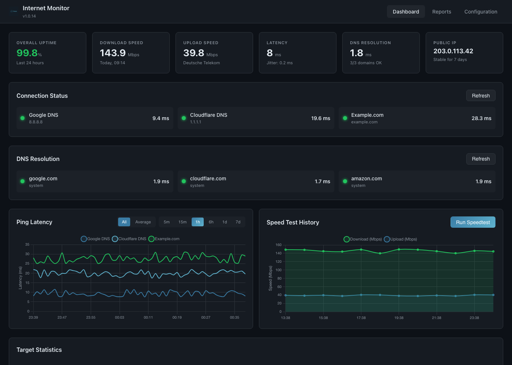

# Internet Monitor — Home Assistant Add-on

Monitor your internet connection with continuous ping tests, speedtests, DNS lookups, and public IP tracking.



## Installation

1. Go to **Settings** → **Apps** → **Install app**
2. Click the menu (⋮) → **Repositories** and add:
   ```
   https://github.com/ITmokel/internetmonitor-ha-addon
   ```
3. Find **Internet Monitor** and click **Install**
4. Click **Start**
5. Open the web interface at `http://homeassistant.local:3000`

All settings (ping interval, speedtest interval, data retention, etc.) are managed through the **Configuration** tab in the web interface — no add-on options need to be set in Home Assistant.

## Features

- **Ping Monitoring** — Continuously monitor latency to configurable targets
- **Speedtest** — Periodic download/upload speed tests
- **DNS Resolution** — Track lookup times and success rates
- **Public IP Tracking** — Detect IP changes with history
- **Real-time Dashboard** — Live charts with time-range selection (5 min → 7 days)
- **Reports** — Daily breakdowns, worst-day analysis, outage detection

## Supported Architectures

![amd64][amd64-shield] ![aarch64][aarch64-shield] ![armv7][armv7-shield]

[amd64-shield]: https://img.shields.io/badge/amd64-yes-green.svg
[aarch64-shield]: https://img.shields.io/badge/aarch64-yes-green.svg
[armv7-shield]: https://img.shields.io/badge/armv7-yes-green.svg

## License Notice

This add-on uses the [Ookla Speedtest CLI](https://www.speedtest.net/apps/cli). By using this add-on, you agree to Ookla's [Terms of Service](https://www.speedtest.net/about/eula) and [Privacy Policy](https://www.speedtest.net/about/privacy). A Python-based fallback (`speedtest-cli`) is used if the Ookla CLI is unavailable.
